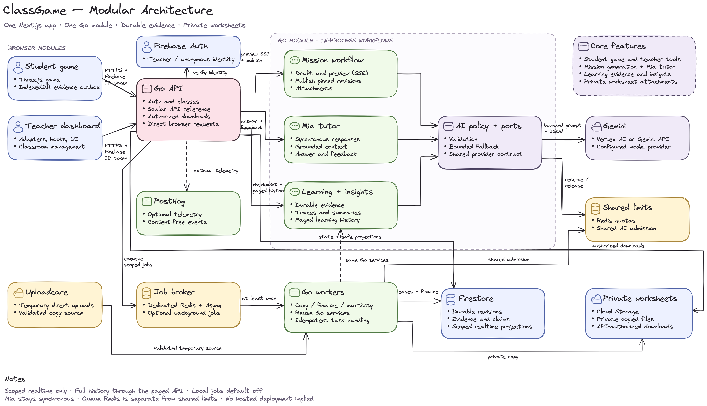
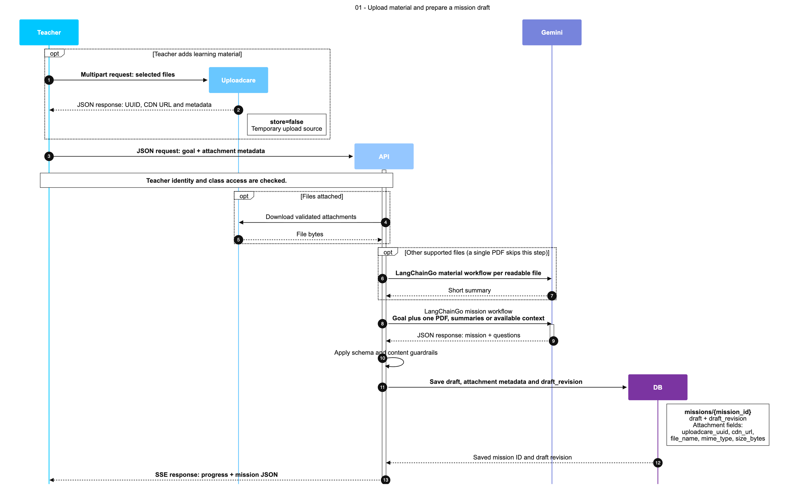
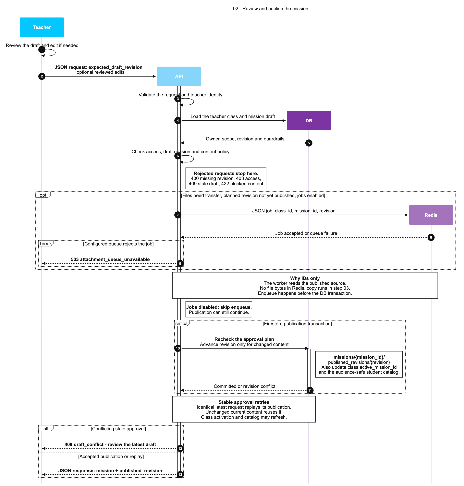
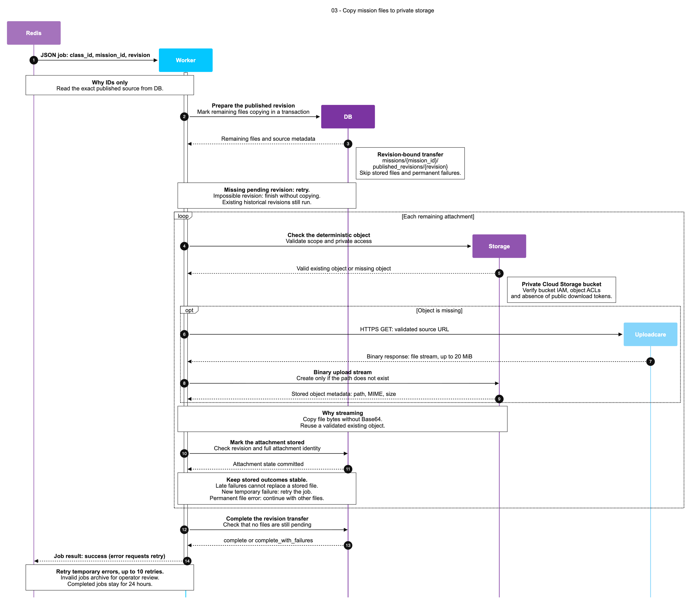
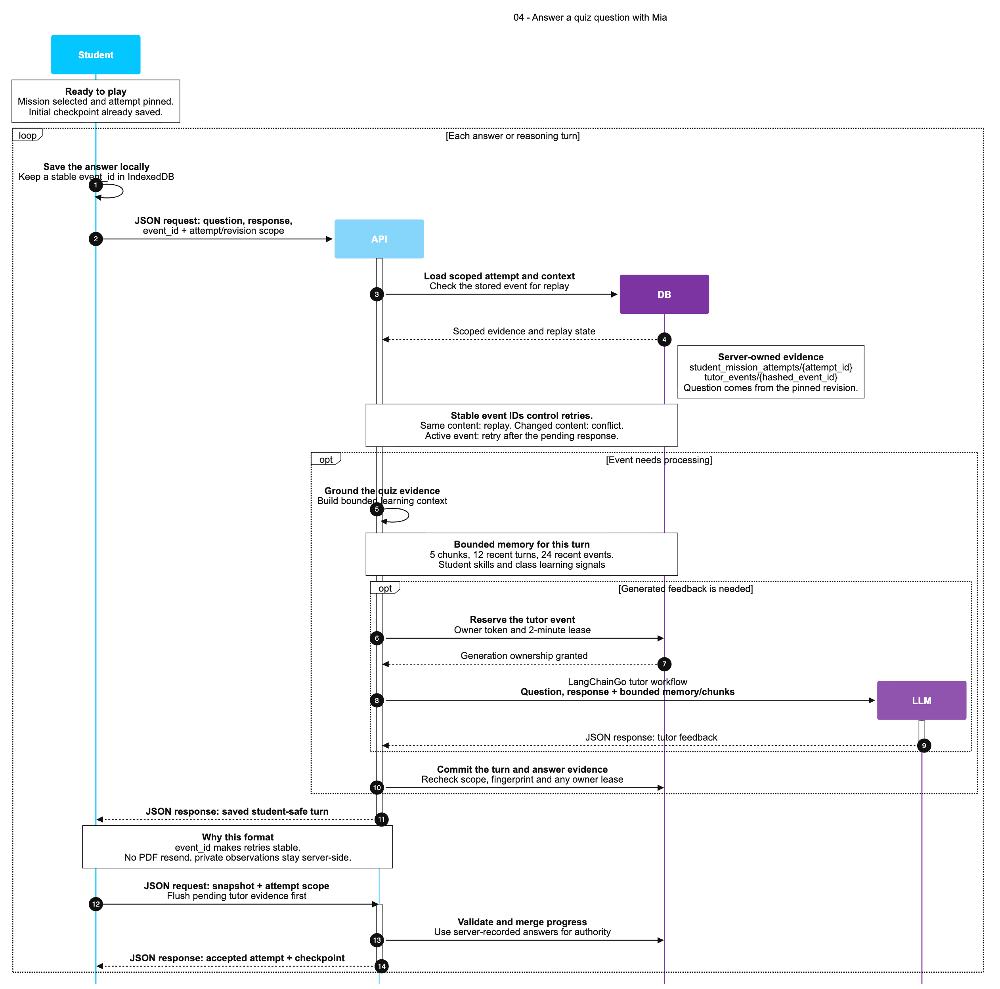
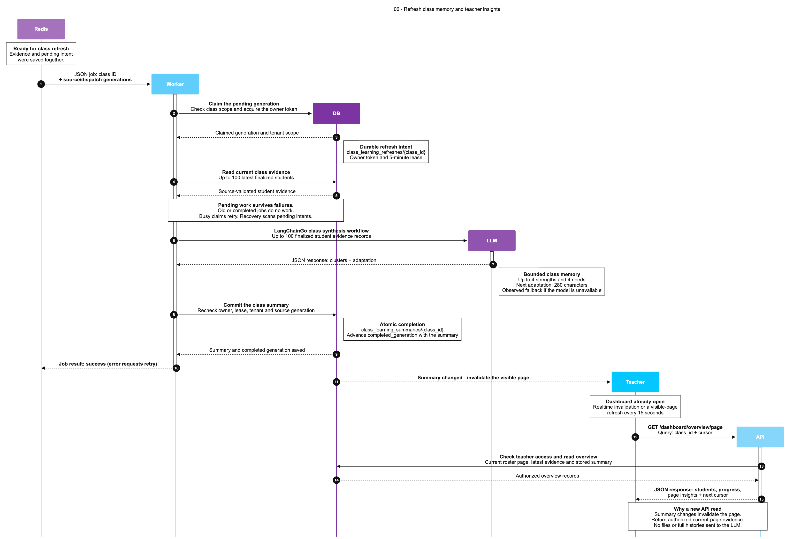

# ClassGame

**The optional homework that takes notes for the teacher.**

A teacher describes today's lesson. Mia creates a short review mission; students play in a 3D classroom, receive adaptive help, and leave observable learning evidence for the teacher.

[Watch the demo](https://www.youtube.com/watch?v=mvsbSKlGfyE) · [Run locally](docs/development/LOCAL-SETUP.md) · [Documentation](docs/README.md) · [API reference](docs/reference/API.md)

The previous hosted deployment is offline. See [hosting history](docs/operations/HOSTING-HISTORY.md) for its dated shutdown record.

## Contents

- [Architecture](#architecture)
  - [Running and evaluating Mia](#running-and-evaluating-mia)
  - [System design](#system-design)
- [Architecture decisions and trade-offs](#architecture-decisions-and-trade-offs)
- [Mission flows](#mission-flows)
- [Product tour](#product-tour)
- [Reproducible setup and testing](#reproducible-setup-and-testing)
- [Documentation](#documentation)
- [Deployment](#deployment)
- [Monthly costs](#monthly-costs)
- [Repository layout](#repository-layout)
- [Credits](#credits)
- [Technology trade-offs](#technology-trade-offs)
  - [API runtime](#api-runtime)
  - [Database](#database)
    - [Monthly database cost](#monthly-database-cost)
  - [Authentication](#authentication)
  - [LLM models](#llm-models)
    - [Monthly LLM cost](#monthly-llm-cost)
  - [Evaluation tooling](#evaluation-tooling)
  - [Frontend framework](#frontend-framework)

## Architecture

The teacher dashboard uses Next.js, React and TypeScript. Three.js renders the student classroom in the browser. A Go API manages missions and tutoring. Firestore stores student progress and sends live updates to the dashboard. Optional Go workers use Asynq and a dedicated Redis broker for background jobs.

### Running and evaluating Mia

- **Tooling.** Run `pnpm run dev` from the repository root. Turborepo starts Next.js and the Go API together. Air rebuilds the API when Go files change. The offline Python eval runner checks the same Go policies that handle tutor requests. [Local setup](docs/development/LOCAL-SETUP.md) · [Evaluation guide](evals/README.md)
- **Models.** Gemini 3.6 Flash and Gemini 4 Argon each answered the same four synthetic science questions through Vertex AI. Both got the core answer right in all four. All factual claims stayed within the lesson in three Argon responses and one Flash response. Flash had the lower median turn time (5.15 s versus 7.20 s). [Comparison report, questions and results](evals/comparisons/2026-11-25-mia-water-cycle/README.md)
- **Evaluation frameworks.** Run `pnpm run eval` to start the web app, API and Genkit Developer UI. The panel shows how Genkit (Go) and DeepEval (Python) scored the same eight saved responses. Each checks source IDs offline and can run the same Vertex judge to check claims against the lesson. [Framework comparison and results](evals/platform/framework-comparison/README.md)
- **Token optimization.** For each tutor turn, the API retrieves up to five lesson passages. If none are usable, Mia uses the published question and skips the model call. Worksheet summaries have a 900-token output limit. Firestore records input, response, thinking and total tokens reported for accepted AI tutor turns. [Tutor retrieval](api/internal/modules/students/tutoring.go) · [Tutor generation](api/internal/modules/generation/tutoring.go) · [Worksheet summaries](api/internal/modules/generation/attachments.go) · [Mia prompt experiment: answer quality, tokens and cost](evals/comparisons/2026-11-25-mia-prompt/README.md)

### System design

The system design is documented in the guides below. They describe the implemented architecture; the diagram does not represent a currently hosted deployment.

| Guide | Covers |
| --- | --- |
| [System architecture](docs/architecture/SYSTEM.md) | Components, capability ownership, learning loop, and system invariants |
| [Module boundaries](docs/architecture/MODULES.md) | Module structure, dependency direction, and public contracts |
| [Data model](docs/reference/DATA-MODEL.md) | Storage ownership, immutable revisions, and student projections |
| [API contracts](docs/reference/API.md) | Authentication, routes, pagination, streaming, and errors |
| [Background jobs](docs/architecture/TASK-PORTABILITY.md) | Queue boundaries, delivery behavior, and recovery constraints |
| [AI quality and evidence](docs/architecture/AI-QUALITY.md) | Tutor context, retrieval, fallbacks, and private information boundaries |

The diagram below shows the components and their connections. Continue with [architecture decisions and trade-offs](#architecture-decisions-and-trade-offs) for the choices behind the design, and [mission flows](#mission-flows) for six sequence diagrams.

<p align="center">
  
</p>

The Excalidraw version below shows the same architecture as editable boxes and connections. Download the [editable source](assets/diagrams/architecture/excalidraw/architecture.excalidraw) and open it in [Excalidraw](https://excalidraw.com/).

<p align="center">
  <a href="assets/diagrams/architecture/excalidraw/architecture.png"></a>
</p>

## Architecture decisions and trade-offs

See the [technology trade-offs](#technology-trade-offs) for the API, database, authentication, LLMs, evals, and frontend. The choices below cover job delivery and application structure.

| Decision and current choice | Relevant alternatives | Why it fits ClassGame | Trade-off / when to reconsider |
| --- | --- | --- | --- |
| **Background delivery: Redis + Asynq** | Google Cloud Tasks | A dedicated Redis broker and Go workers run locally or on another cloud without Cloud Tasks delivery endpoints or Google OIDC setup. Module-owned messages keep job meaning outside the transport. See [task portability](docs/architecture/TASK-PORTABILITY.md). | Cloud Tasks manages the queue service; Redis moves broker persistence, capacity, backups and worker operation to us. Delivery can repeat: stable IDs and domain checks remain necessary. The current adapter needs standalone-compatible Redis, not an assumed Redis Cluster deployment. Prefer managed delivery if lower operating effort matters more than queue portability. |
| **Application shape: modular monolith with API/worker roles** | Separate microservices | One Go module reuses the same policies and processors, with narrow module contracts. API and worker processes can have separate roles without splitting business logic into network services. See [system boundaries](docs/architecture/SYSTEM.md). | Releases must keep producers, workers and stored contracts compatible. Separate services become useful when independent ownership, isolation or scaling needs justify extra network calls, deployments and recovery work. A small project does not need that cost by default. |

Two boundaries matter when discussing portability:

- **Redis is not the durable learning database.** `TASKS_REDIS_URL` is a dedicated job broker; `REDIS_URL` handles quotas and shared AI admission. Firestore keeps accepted learning state and recovery markers. Broker loss still needs recovery; retries do not guarantee exactly-once external effects. [Queue operations](docs/operations/QUEUES.md).
- **Moving compute is different from replacing services.** API/web containers and a compatible Redis broker can move to another host, but Firebase Auth, Firestore, object storage and Google AI remain dependencies. Mia's interactive tutor calls stay synchronous; file copies and selected learning jobs run in the background. [Architecture](docs/architecture/SYSTEM.md).

Provider references: [Go concurrency](https://go.dev/doc/faq#goroutines), [Node.js I/O and CPU work](https://nodejs.org/en/learn/asynchronous-work/dont-block-the-event-loop), [Next.js static-export limits](https://nextjs.org/docs/app/guides/static-exports#unsupported-features), [Firestore transactions](https://firebase.google.com/docs/firestore/manage-data/transactions), [PostgreSQL constraints](https://www.postgresql.org/docs/current/ddl-constraints.html), [MongoDB data modeling](https://www.mongodb.com/docs/manual/data-modeling/), and [Cloud Tasks delivery](https://docs.cloud.google.com/tasks/docs/dual-overview).

## Mission flows

Read the steps in order. **Starts with** shows who begins each flow. Select a diagram to open the full PNG. See the [step index](assets/diagrams/steps/README.md) for all diagrams and the style guide.

| Step | Starts with | Flow | Diagram |
|:---:|---|---|:---:|
| 01 | **Teacher** | **Upload material and prepare a mission draft**<br>Upload optional files, generate questions, and save a draft for teacher review.<br>[Guide](assets/diagrams/steps/01-mission-draft/README.md) · [Mermaid source](assets/diagrams/steps/01-mission-draft/SEQUENCE.txt) | <a href="assets/diagrams/steps/01-mission-draft/diagram.png"></a> |
| 02 | **Teacher** | **Review and publish the mission**<br>Check the reviewed revision, prepare file-copy jobs, and publish through a DB transaction.<br>[Guide](assets/diagrams/steps/02-mission-publication/README.md) · [Mermaid source](assets/diagrams/steps/02-mission-publication/SEQUENCE.txt) | <a href="assets/diagrams/steps/02-mission-publication/diagram.png"></a> |
| 03 | **Redis** | **Copy mission files to private storage**<br>Workers load the published revision, copy files with retry checks, and save each result.<br>[Guide](assets/diagrams/steps/03-attachment-transfer/README.md) · [Mermaid source](assets/diagrams/steps/03-attachment-transfer/SEQUENCE.txt) | <a href="assets/diagrams/steps/03-attachment-transfer/diagram.png"></a> |
| 04 | **Student** | **Answer a quiz question with Mia**<br>Save the answer locally, get grounded feedback with bounded context, and save progress.<br>[Guide](assets/diagrams/steps/04-quiz-play/README.md) · [Mermaid source](assets/diagrams/steps/04-quiz-play/SEQUENCE.txt) | <a href="assets/diagrams/steps/04-quiz-play/diagram.png"></a> |
| 05 | **Student** | **Finish the quiz and refresh student memory**<br>Confirm completion, finalize private evidence, and replace the compact student memory.<br>[Guide](assets/diagrams/steps/05-learning-memory/README.md) · [Mermaid source](assets/diagrams/steps/05-learning-memory/SEQUENCE.txt) | <a href="assets/diagrams/steps/05-learning-memory/diagram.png"></a> |
| 06 | **Redis** | **Refresh class memory and teacher insights**<br>Build a bounded class summary, reject stale work, and refresh the teacher's visible insights.<br>[Guide](assets/diagrams/steps/06-class-insights/README.md) · [Mermaid source](assets/diagrams/steps/06-class-insights/SEQUENCE.txt) | <a href="assets/diagrams/steps/06-class-insights/diagram.png"></a> |

## Product tour

Every screen below is from the working product. Select any image to open it at full resolution.

| Student experience | Teacher experience |
|:---:|:---:|
| **Join a class in seconds**<br><a href="assets/pitch/01-0.png"></a> | **Student and teacher experiences, side by side**<br><a href="assets/pitch/01-1.png"></a> |
| **Explore the 3D classroom**<br><a href="assets/pitch/01-2.png"></a> | **Create a mission with Mia**<br><a href="assets/pitch/02-1.png"></a> |
| **Ground missions in real worksheets**<br><a href="assets/pitch/02-2.png"></a> | **Review and refine AI-generated questions**<br><a href="assets/pitch/02-3.png"></a> |
| **Inspect the mission flow**<br><a href="assets/pitch/02-4.png"></a> | **Publish the mission to the class**<br><a href="assets/pitch/03-1.png"></a> |
| **Choose a mission from the classroom**<br><a href="assets/pitch/03-2.png"></a> | **Follow live, grounded tutor turns**<br><a href="assets/pitch/03-3.png"></a> |
| **See the evidence-backed learning flow**<br><a href="assets/pitch/03-4.png"></a> | **Turn the completed mission into insight**<br><a href="assets/pitch/03-5.png"></a> |
| **Understand the whole class at a glance**<br><a href="assets/pitch/04-1.png"></a> | **Inspect the production architecture in-app**<br><a href="assets/pitch/05-1.png"></a> |

---

## Reproducible setup and testing

Use the canonical [local setup](docs/development/LOCAL-SETUP.md), [configuration](docs/reference/CONFIGURATION.md), and [validation](docs/development/VALIDATION.md) guides.

Clone [velrino/classgame](https://github.com/velrino/classgame), configure Firebase and Redis, then start `api/` and `web/` as described in [local setup](docs/development/LOCAL-SETUP.md). Open [teacher login](http://localhost:3000/login) or the [student game](http://localhost:3000/home).

See [evaluations](evals/README.md) for synthetic policy checks and optional local integration suites. The default Python runner sends JSON through standard input to a Go bridge built from `api/cmd/evals/evalbridge`. The bridge calls the API's production functions and returns JSON through standard output for Python to check and report. Frontend policy suites use Node bridges. Default checks run offline without a running API server or paid AI calls.

## Documentation

Start with [docs/README.md](docs/README.md): architecture, development, operations, API/configuration reference, and implementation plans each have a canonical home.

Coding assistance starts at the [root router](AGENTS.md) and scoped package guides. Use the [AI index](docs/ai/README.md) for workspace/evaluation guidance and [processes](docs/processes/README.md) for review and release integration.

Repository skills live in [.agents/skills](.agents/skills); contribution and workspace contracts live in [agents/AGENTS.md](agents/AGENTS.md).

## Deployment

See [Cloud Run operations](docs/operations/CLOUD-RUN.md). Local execution does not recreate deleted hosted resources.

## Monthly costs

Each column estimates one month of ClassGame usage in USD for the stated number of active students and teachers combined. Both totals include the Go API, live tutoring and Firebase. The frontend host is the only change. These are planning estimates for text-only missions. The previous deployment is offline.

| Estimated monthly cost (USD) | 1 user | 100 users | 1,000 users | 10,000 users | 100,000 users |
| --- | ---: | ---: | ---: | ---: | ---: |
| Vertex AI · Gemini 3.7 Flash | $0.05 | $4.50 | $45.00 | $450.00 | $4,500.00 |
| Cloud Run · Go API compute | $0.09 | $2.34 | $16.85 | $67.39 | $134.78 |
| Go API · outbound traffic | $0.00 | $0.01 | $0.12 | $1.17 | $11.72 |
| Firestore · reads and writes | $0.00 | $0.00 | $0.00 | $0.81 | $17.01 |
| Firestore · storage and outbound traffic | $0.00 | $0.00 | $0.00 | $0.00 | $3.04 |
| Redis · API quotas and shared AI limits | $0.00 | $0.08 | $0.80 | $8.00 | $80.00 |
| Firebase Auth with Identity Platform | $0.00 | $0.00 | $0.00 | $0.00 | $275.00 |
| Uploadcare and Cloud Storage · no attachments | $0.00 | $0.00 | $0.00 | $0.00 | $0.00 |
| Asynq worker and dedicated Redis broker · disabled | $0.00 | $0.00 | $0.00 | $0.00 | $0.00 |
| Frontend option 1 · Cloud Run compute, requests and traffic | $0.00 | $0.10 | $1.01 | $10.14 | $101.35 |
| Frontend option 2 · Netlify Free or Pro | $0.00 | $0.00 | $0.00 | $20.00 | $120.00 |
| **Total · Cloud Run frontend** | **$0.14** | **$7.03** | **$63.78** | **$537.51** | **$5,122.90** |
| **Total · Netlify frontend** | **$0.14** | **$6.93** | **$62.77** | **$547.37** | **$5,141.55** |

**What drives the estimate**

- **AI usage.** Allow 10 paid calls per active user across tutoring and mission generation. Budget 1,500 uncached input tokens and 900 output tokens per call, including reasoning. The global Gemini 3.7 Flash rates through December 31, 2026 are $0.75 and $3.75 per million tokens after promotional credits. At the published January 2027 rates, the AI row doubles. [Vertex AI pricing](https://cloud.google.com/model-garden/pricing)
- **Cloud Run and traffic.** Both services use 1 vCPU and 4 GiB in South Carolina. For the instance-billed API, assume 1, 25, 180, 720 and 1,440 total instance-hours across the five columns, including idle time. That costs $0.0936 per instance-hour. The request-billed frontend uses two active instance-seconds and 20 requests per user. Budget 8 MiB per user for the web app and classroom assets, plus 1 MiB for API responses, at $0.12/GiB to North America. These rows assume the billing account has used its Cloud Run and network free allowances. [API configuration](api/infra/cloud-run/production/cloudbuild.yaml) · [Web configuration](web/infra/cloud-run/production/cloudbuild.yaml) · [Cloud Run pricing](https://cloud.google.com/run/pricing) · [Network pricing](https://cloud.google.com/vpc/network-pricing)
- **Database and sign-in.** Per user, budget 300 Firestore reads including listeners, 100 writes, 0.1 MiB stored and 0.25 MiB sent to browsers. Assume even traffic over 30 days and the default database's free quota. Budget overages at $0.03 per 100,000 reads, $0.09 per 100,000 writes, $0.15/GiB-month stored and $0.12/GiB sent. Sign-in assumes one Tier 1 identity per user, anonymous cleanup off and the first 50,000 monthly users free. [Firestore pricing](https://cloud.google.com/firestore/pricing) · [Identity Platform pricing](https://cloud.google.com/identity-platform/pricing)
- **Redis and optional jobs.** Budget 400 Redis commands per user at $0.20 per 100,000 commands on Upstash Pay as You Go, with storage and transfer within its included amounts. The API runs with jobs disabled. Enabling attachment copying adds a continuous worker, a separate Redis broker, file storage and transfer. [Redis pricing](https://upstash.com/pricing/redis) · [ClassGame queue requirements](docs/operations/QUEUES.md)
- **Netlify frontend.** The alternative hosts the Next.js app from `web/` and calls the same Go API. Budget one production deploy per month, 20 web requests, 8 MiB delivered and 0.25 GB-seconds of function compute per user. At 100,000 users this uses about 17,262 credits. The estimate uses Free through 1,000 users, then the $20 Pro plan with 3,000 credits and $10 per additional pack of 1,500. [Next.js on Netlify](https://docs.netlify.com/build/frameworks/framework-setup-guides/nextjs/overview/) · [Netlify pricing](https://www.netlify.com/pricing/)

Totals sum the displayed resource costs to the cent. Build and image storage, secrets, logging and optional analytics are assumed to stay within their included allowances. Taxes, backups and paid support are outside the estimate.

## Repository layout

```text
.agents/skills/          Repository skills for reviews, evals, and background jobs
.github/workflows/      CI checks for the API, web app, and policy evaluations
agents/                 AI contribution and workspace contracts
api/                    Go API, worker roles, provider integrations, and eval bridges
web/                    Next.js teacher dashboard and student 3D game
evals/                  Python runners, synthetic datasets, and local evaluation tools
docs/                   Canonical project documentation
assets/                 Source media, credits, diagrams, and generation notes
scripts/                Operational and asset commands
AGENTS.md               Contributor router and repository rules
firebase*.json          Firebase configuration and local emulator settings
firestore.rules         Browser access rules
firestore.indexes.json  Firestore query indexes
```

## Credits

[Classroom model](https://sketchfab.com/3d-models/low-poly-classroom-8b1bf103c90349d981c9c2ae1c0596e5) by Mumladze28; [avatar credits and generation notes](assets/3d/avatars/chibi-band/README.md); [worksheet sources](assets/grade/README.md). Asset licenses stay beside their files. The dashboard uses shadcn/ui and a shell adapted from shadcn-admin.


## Technology trade-offs

[API runtime](#api-runtime) · [Database](#database) · [Monthly database cost](#monthly-database-cost) · [Authentication](#authentication) · [LLM models](#llm-models) · [Evaluation tooling](#evaluation-tooling) · [Frontend framework](#frontend-framework)

These tables compare the choices I would make if I built ClassGame from scratch as a solo developer.

### API runtime

ClassGame needs a synchronous tutor API, Firestore transactions, and background workers for jobs such as copying attachments. Runtime overhead is the CPU time and memory needed to run the program in addition to the work it does for each request.

| Criterion | Go + Echo **(chosen)** | Node.js + TypeScript | Python + FastAPI |
| --- | --- | --- | --- |
| How code runs | Go compiles to machine code before deployment. | V8 can compile frequently used JavaScript to machine code as it runs. | Standard CPython runs Python bytecode. Libraries can run heavy work in native code. |
| HTTP routing and validation | Echo handles routes and middleware. I maintain validation and OpenAPI definitions. | I choose a framework and add runtime validation for incoming data. | Typed request models provide runtime validation and generate OpenAPI. |
| Waiting on Firestore or Gemini | Lightweight goroutines let many requests wait at once. Contexts carry deadlines and cancellation to SDK calls. | The event loop lets other requests continue while an I/O operation is waiting. | Async handlers can serve other requests while waiting on an async SDK. Blocking calls can hold up the event loop. |
| CPU-heavy tasks | Goroutines can run CPU work across multiple cores within one process. | Worker threads or processes keep heavy computation off the main event loop. | With the standard GIL enabled, only one thread at a time runs Python code in a process. Worker processes can use multiple cores. |
| Memory as load grows | Goroutines start with small stacks and share process memory. The garbage collector frees unused objects. | V8 manages a JavaScript heap. Worker threads have their own JavaScript environments. | Each worker process has its own interpreter and app state. CPython mainly frees objects through reference counting and also collects cycles. |
| Startup and container size | The container ships a native binary. Startup still includes loading configuration and opening connections. | The container ships Node.js and app dependencies. Startup includes loading the JavaScript modules. | The container ships Python and installed packages. Startup includes importing modules. |
| Shared code | The HTTP and worker roles share Go domain rules. The web uses a separate TypeScript contract. | The API and web can share TypeScript types and tooling. | The API can use Python-native ML tools. The web needs a TypeScript contract. |
| Deployment | One binary can run either the HTTP or worker role. | I ship the Node runtime and choose a job runner. | I ship the Python runtime and choose a job runner. |

**Rule of thumb for similar API workloads.** Go tends to have the lowest runtime overhead because it ships native code and uses lightweight goroutines. Node.js often sits in the middle and handles requests that spend most of their time waiting on I/O efficiently. Standard Python (CPython) tends to have the most overhead when the request does CPU work in Python itself, because it runs bytecode through an interpreter. Actual CPU and memory use depend on the workload, libraries, and worker setup.

I chose Go because one binary can serve the tutor API and run workers with the same domain rules and explicit cancellation. For a Mia request, time spent waiting on Firestore or Gemini can matter more than the time the API spends executing code. For CPU-heavy work, such as processing a large document, runtime and worker setup matter more. To compare costs, I would measure memory, CPU, startup time, image size, and p95 latency under the same ClassGame workload. [HTTP server](api/internal/app/server.go) · [Container build](api/infra/cloud-run/Dockerfile) · [Worker roles](docs/operations/QUEUES.md) · [Go runtime FAQ](https://go.dev/doc/faq) · [Node.js V8 engine](https://nodejs.org/en/learn/getting-started/the-v8-javascript-engine) · [Node.js event loop](https://nodejs.org/en/learn/asynchronous-work/dont-block-the-event-loop) · [Python glossary](https://docs.python.org/3/glossary.html) · [Python free threading](https://docs.python.org/3/howto/free-threading-python.html) · [FastAPI features](https://fastapi.tiangolo.com/features/)

### Database

ClassGame needs to store mission revisions and student attempts, update related records in transactions, and show teachers class progress as it changes.

| Criterion | Firestore + Firebase Auth **(chosen)** | MongoDB Atlas | PostgreSQL on Supabase |
| --- | --- | --- | --- |
| Data model | Documents hold mission revisions and student attempts. | Documents fit mission content with a variable shape. | Tables and foreign keys model classes, enrollments, missions, and attempts. |
| Live dashboard | Browser listeners subscribe to selected class progress views. | A backend consumes change streams and relays authorized updates to browsers. | Supabase Realtime delivers database changes to subscribed browsers. |
| Access control | Firebase Auth provides identity. Firestore rules control browser reads, and the API handles writes. | I connect identity and enforce classroom access in the API and update stream. | I define row-level policies for the records each student or teacher can read. |
| Reporting | Known dashboard queries use indexes and prepared views. Cross-class reports need more planning. | Aggregation pipelines can summarize documents along several dimensions. | SQL joins and aggregates suit reports across classes and missions. |
| What I maintain | Indexes, dashboard views, and Firebase rules. | Document layout, transaction boundaries, and reconnect handling for live updates. | Schema migrations, row policies, compute sizing, and Realtime usage. |

I chose Firestore because I can deliver a live teacher dashboard with managed browser listeners and access rules while keeping writes in the Go API. That reduces the amount of realtime infrastructure I maintain on my own. MongoDB is attractive if document queries and aggregation are the priority. Supabase is attractive if relational constraints and cross-class reporting drive the design. [ClassGame data model](docs/reference/DATA-MODEL.md) · [Access rules](firestore.rules) · [Firestore listeners](https://firebase.google.com/docs/firestore/query-data/listen) · [MongoDB change streams](https://www.mongodb.com/docs/manual/changestreams/) · [PostgreSQL constraints](https://www.postgresql.org/docs/current/ddl-constraints.html) · [Supabase Realtime](https://supabase.com/docs/guides/realtime/postgres-changes)

#### Monthly database cost

I use the same workload assumptions as the [project cost estimate](#monthly-costs). Each monthly active user generates 300 reads and 100 writes, including reads for live updates, and accounts for 0.1 MiB of stored data and 0.25 MiB of outbound data. The 30-day model spreads operations evenly and treats the stored volume as a monthly snapshot. Actual database size depends on indexes, copies of data, and retention.

| Workload or estimated cost (USD/month) | 1 user | 100 users | 1,000 users | 10,000 users | 100,000 users |
| --- | ---: | ---: | ---: | ---: | ---: |
| Stored data | 0.10 MiB | 10 MiB | 100 MiB | 0.977 GiB | 9.766 GiB |
| Reads / writes per month | 300 / 100 | 30,000 / 10,000 | 300,000 / 100,000 | 3,000,000 / 1,000,000 | 30,000,000 / 10,000,000 |
| Outbound data per month | 0.25 MiB | 25 MiB | 250 MiB | 2.441 GiB | 24.414 GiB |
| **Cloud Firestore Standard** | **$0.00** | **$0.00** | **$0.00** | **$0.81** | **$20.05** |
| **MongoDB Atlas Free** | **$0.00** | **$0.00** | **$0.00** | Over 512 MB | Over 512 MB |
| **MongoDB Atlas Flex** | **$7.92** | **$7.92** | **$7.92** | **$7.92** | Over 5 GB |
| **MongoDB Atlas Dedicated** | **$57.60+** | **$57.60+** | **$57.60+** | **$57.60+** | **$57.60+** |
| **PostgreSQL on Supabase** | **$0.00** (Free) | **$0.00** (Free) | **$0.00** (Free) | **$25.00** (Pro) | **$25.50** (Pro + disk) |

- **Firestore Standard** uses the regional rates and default-database free quotas from the project estimate. The $20.05 covers $17.01 in operations and $3.04 in storage and outbound data. [Firestore pricing](https://cloud.google.com/firestore/pricing)
- **MongoDB Atlas** assumes the first three workloads fit the 512 MB Free cluster and its usage limits. Flex includes 5 GB of storage. The table estimates 720 hours at $0.011/hour in the 0–100 operations/sec tier. Dedicated uses the starting rate of about $0.08/hour for 720 hours in each scenario. Region, disk size, and network use affect the actual charge. [Atlas pricing](https://www.mongodb.com/pricing) · [Atlas Flex rates](https://www.mongodb.com/docs/atlas/billing/atlas-flex-costs/)
- **Supabase PostgreSQL** uses Free up to 500 MB of database size and 5 GB of egress. Pro starts at $25/month, includes 8 GB of disk and 250 GB of egress, and provides compute credits for one Micro instance. I model 12 GB of provisioned disk in the largest scenario, adding about $0.50 for 4 GB above the included disk at $0.125/GB-month. The estimate assumes Micro can handle the workload. A larger instance or disk would raise the bill. [Supabase pricing](https://supabase.com/pricing) · [Disk size billing](https://supabase.com/docs/guides/platform/manage-your-usage/disk-size)

The table covers database charges and the required plan fee. Auth, backup add-ons, and additional realtime delivery charges are outside this estimate.

### Authentication

Teachers sign in with Google or email and password. Students join a class with a code and get an anonymous identity, so they can start without creating a login. The Go API checks identity and class access.

| Criterion | Firebase Auth **(chosen)** | Custom auth | Clerk |
| --- | --- | --- | --- |
| Teacher sign-in | Google and email/password through Firebase. I build the ClassGame sign-in screen. | I integrate Google sign-in and build the email/password flow. | Prebuilt sign-in and account components fit the Next.js dashboard. |
| Student entry | Anonymous sign-in creates a user ID without asking for email or a password. The API handles enrollment. | I can design a guest session around the class code and decide how it expires or resumes. | I would design a guest session around the class code alongside the managed teacher sign-in. |
| API and browser access | The Go API verifies Firebase ID tokens. Firestore rules can use the same identity for live browser reads. | The Go API would verify my sessions. Direct Firestore reads would also need a Firebase identity, or live updates could go through the API. | The Go API would verify Clerk sessions. I would need my own bridge for direct Firestore reads or deliver live updates through the API. |
| What I maintain | I configure providers and maintain teacher eligibility, class membership, and Firestore rules. | I own session expiry and revocation, credential storage and recovery, and sign-in abuse controls. | Clerk manages teacher sign-in UI and sessions. I maintain the classroom access rules, guest flow, and Firestore integration. |

I chose Firebase Auth because teacher sign-in, anonymous student entry, and live Firestore reads can use the same identity. Clerk is attractive if prebuilt teacher sign-in screens matter most. Custom auth gives me control over the guest flow and adds day-to-day work around credentials and sessions. [ClassGame API access](docs/reference/API.md) · [Firestore rules](firestore.rules) · [Firebase anonymous sign-in](https://firebase.google.com/docs/auth/web/anonymous-auth) · [Firebase token verification](https://firebase.google.com/docs/auth/admin/verify-id-tokens) · [Clerk sign-in](https://clerk.com/docs/nextjs/reference/components/authentication/sign-in) · [Clerk Firebase integration status](https://clerk.com/docs/guides/development/integrations/databases/firebase)

### LLM models

Mia needs a model that can read worksheets, answer from selected lesson passages, and return JSON that the Go API can validate.

| Criterion | Gemini 3.7 Flash **(chosen)** | GPT-5.4 mini | Claude Sonnet 5.5 |
| --- | --- | --- | --- |
| Role in ClassGame | Configured as the default Gemini model on Vertex AI. It supports short tutor turns and worksheet summaries. | A candidate for frequent short tutor turns. I would check whether it follows the lesson and keeps follow-up questions useful. | A candidate for more demanding worksheet analysis. I would check whether its answers justify the higher token rate. |
| Worksheet inputs | Accepts PDF and image inputs. | Can read PDFs through the Responses API, which sends both extracted text and page images. | Accepts PDF and image inputs through the Claude API. |
| Structured tutor output | Supports schema-based JSON. | Supports Structured Outputs. | Supports structured JSON output. |
| Standard input / output, USD per 1M tokens | $0.75 / $3.75 on global Vertex through December 31, 2026. $1.50 / $7.50 from January 1, 2027. | $0.75 / $4.50 through the OpenAI API. | $2.00 / $10.00 through the Claude API. |
| Evidence from ClassGame | The saved comparison tested Gemini 3.6 Flash and Gemini 4 Argon. Both returned valid tutor responses on all four cases. | No ClassGame benchmark yet. | No ClassGame benchmark yet. |

I chose Gemini Flash because one model supports both worksheet reading and structured tutor turns at a token rate that fits frequent calls. I serve it through Vertex AI. The four-case experiment also showed the trade-off within Gemini. Flash 3.6 had a lower median turn time than Argon (5.15 s vs. 7.20 s), while Argon kept every factual claim within the lesson on three cases versus one for Flash. To compare GPT or Claude, I would run the same lesson cases and measure answer quality, latency, and cost per accepted turn. [Mia comparison](evals/comparisons/2026-11-25-mia-water-cycle/README.md) · [Gemini 3.7 Flash](https://docs.cloud.google.com/gemini-enterprise-agent-platform/models/gemini/3-7-flash) · [Vertex pricing](https://cloud.google.com/model-garden/pricing) · [GPT-5.4 mini](https://developers.openai.com/api/docs/models/gpt-5.4-mini) · [OpenAI PDF inputs](https://developers.openai.com/api/docs/guides/file-inputs) · [Claude Sonnet 5.5](https://platform.claude.com/docs/en/models/sonnet-5-5/overview) · [Claude PDF inputs](https://platform.claude.com/docs/en/build-with-claude/pdf-support) · [Claude structured outputs](https://platform.claude.com/docs/en/build-with-claude/structured-outputs)

#### Monthly LLM cost

I use the same assumptions as the [project cost estimate](#monthly-costs). Each monthly active user makes **10 paid model calls** across tutoring and mission generation. Each call uses **1,500 uncached input tokens** and **900 billed output tokens**, including reasoning tokens where billed as output.

| Volume or estimated cost (USD/month) | 1 user | 100 users | 1,000 users | 10,000 users | 100,000 users |
| --- | ---: | ---: | ---: | ---: | ---: |
| Model calls | 10 | 1,000 | 10,000 | 100,000 | 1,000,000 |
| Input tokens | 15,000 | 1.5M | 15M | 150M | 1.5B |
| Output tokens | 9,000 | 0.9M | 9M | 90M | 900M |
| **Gemini 3.7 Flash on Vertex AI**, through December 31, 2026 | **$0.05** | **$4.50** | **$45.00** | **$450.00** | **$4,500.00** |
| Gemini 3.7 Flash on Vertex AI, from January 1, 2027 | $0.09 | $9.00 | $90.00 | $900.00 | $9,000.00 |
| **GPT-5.4 mini** | **$0.05** | **$5.18** | **$51.75** | **$517.50** | **$5,175.00** |
| **Claude Sonnet 5.5** | **$0.12** | **$12.00** | **$120.00** | **$1,200.00** | **$12,000.00** |

At 1,000 users, the Gemini estimate through December 31 is 15 million input tokens at $0.75 per million plus 9 million output tokens at $3.75 per million, for **$45/month**. At the published January 2027 rates, GPT-5.4 mini costs less than Gemini at the same token volume. Actual token counts can differ by model and response. These estimates cover standard model calls. Caching, batch discounts, tool fees, and taxes are outside the estimate. [Vertex pricing](https://cloud.google.com/model-garden/pricing) · [GPT-5.4 mini pricing](https://developers.openai.com/api/docs/models/gpt-5.4-mini) · [Claude Sonnet 5.5 pricing](https://platform.claude.com/docs/en/models/sonnet-5-5/overview)

### Evaluation tooling

ClassGame needs repeatable checks for tutor policies and browser recovery, plus a way to judge whether Mia's answers stay within the lesson.

| Criterion | Python runner + Go and Node bridges **(chosen for policy checks)** | Genkit Go | DeepEval (Python) |
| --- | --- | --- | --- |
| Production policy coverage | Small bridges call the Go and TypeScript policies used by the app. | Evaluators can call Go directly. TypeScript policies still need a bridge. | Go and frontend policies need a bridge or a running service. |
| Tutor answer quality | The suite checks synthetic rules such as source IDs and fallbacks. Semantic grading needs a separate check. | A custom Go evaluator can score saved answers using a rubric and a model judge. | Built-in and custom metrics give me a starting point for grading saved answers. |
| Inspecting results | Python reads JSON cases and saves assertion results and reports locally. | The Developer UI shows scores and reasons and compares runs. A local runtime runs registered evaluators. | Reports can be exported to local HTML. |
| Cost and repeatability | The default suite uses synthetic data and makes zero model calls. | Deterministic checks can run offline. A model judge adds calls and can vary. | Deterministic metrics can run offline. Model grading needs reviewed examples and a call budget. |
| What I maintain | Case format, report, small bridges, and their toolchains. | Go evaluator code and the browser UI setup. | Python metric code, the rubric, and a way to call app policies. |

I chose the Python runner with bridges for routine checks because one suite can exercise both languages' policies with predictable results and zero model calls. Genkit and DeepEval are useful for a separate question about answer quality. On eight saved Mia answers, their shared Gemini judge produced the same eight source-support verdicts. Each framework agreed with the earlier review on four. [Evaluation scope](docs/ai/EVALUATIONS.md) · [Genkit and DeepEval results](evals/comparisons/2026-11-25-genkit-deepeval/README.md)

**External example · Uber.** Uber Engineering built its own Skill Workshop and evaluation systems for agent skills. It replays real tasks with and without a skill and checks the result and the steps the agent took, such as which tools it used. It also uses examples graded by people to guide model judges. ClassGame's own runner checks tutor and browser policies, and the saved Genkit and DeepEval comparison examines how well Mia's answers stay within the lesson. [Uber Engineering on X](https://x.com/UberEng/status/2125008806249930999) · [Uber Engineering article](https://www.uber.com/us/en/blog/optimizing-ubers-agent-skills/)

### Frontend framework

ClassGame needs a teacher dashboard with nested routes and mission forms, plus an interactive 3D classroom for students. Both experiences use the Go API.

| Criterion | Next.js + React **(chosen)** | React + Vite | Vue + Vite | Angular |
| --- | --- | --- | --- | --- |
| Routing and layouts | File-based routes and nested layouts give teacher and student pages their own shells. | I choose a router and define the nested layouts. | Vue Router supports nested routes. I define the route and layout structure. | Angular Router organizes routes and nested views. |
| Dashboard UI and forms | React offers component options for tables, dialogs, and mission forms. | Uses the same React UI ecosystem. | Vue single-file components put template and logic together. I choose Vue components for tables and editors. | Reactive forms and dependency injection provide consistent patterns for complex forms. |
| Browser 3D | Three.js runs in a client component with access to the canvas and WebGL. | Three.js runs in the browser and can follow the React component lifecycle. | Three.js runs in the browser and can follow the Vue component lifecycle. | Three.js runs in the browser and can follow the Angular component lifecycle. |
| Hosting | The standalone configuration runs on a Node server. | A static build needs a host fallback for direct links to app routes. | A static build needs a host fallback for direct links to app routes. | A browser-only build can use static hosting with a route fallback. |
| What I maintain | Server and client boundaries for browser-only features. | Routing, layout integration, and hosting rules. | Router and UI library integration. | Angular templates, dependency injection, and form conventions. |

I chose Next.js + React for built-in routing and layouts and a broad choice of dashboard components. For ClassGame, those benefits justify managing server and client boundaries. Three.js runs in the browser under any of the four options, so the framework decision comes down to how the app organizes its routes, layouts, and forms. [Web app](web/README.md) · [Standalone build](web/next.config.ts) · [Next.js component boundaries](https://nextjs.org/docs/app/getting-started/server-and-client-components) · [Vite static deployment](https://vite.dev/guide/static-deploy.html) · [Vue Router](https://router.vuejs.org/) · [Angular routing](https://angular.dev/guide/routing) · [Angular forms](https://angular.dev/guide/forms)
