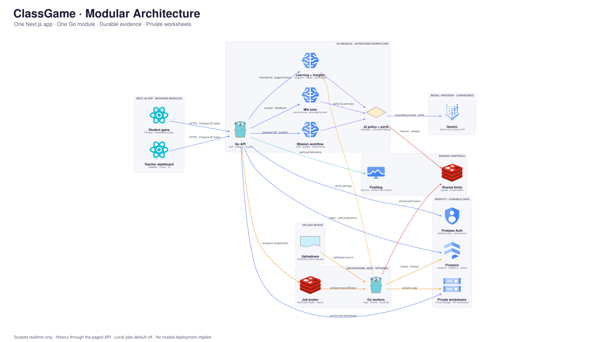

# ClassGame

**The optional homework that takes notes for the teacher.**

A teacher describes today's lesson. Mia creates a short review mission; students play in a 3D classroom, receive adaptive help, and leave observable learning evidence for the teacher.

[Watch the demo](https://www.youtube.com/watch?v=mvsbSKlGfyE) · [Run locally](docs/development/LOCAL-SETUP.md) · [Documentation](docs/README.md) · [API reference](docs/reference/API.md)

The previous hosted deployment is offline. See [hosting history](docs/operations/HOSTING-HISTORY.md) for its dated shutdown record.

## Architecture

One Next.js application, one Go API, and Firebase-backed learning state. Read the [system overview](docs/architecture/SYSTEM.md) and [module boundaries](docs/architecture/MODULES.md).

<p align="center">
  
</p>

## Product tour

Every screen below is from the working product. Select any image to open it at full resolution.

| Student experience | Teacher experience |
|:---:|:---:|
| **Join a class in seconds**<br><a href="assets/pitch/01-0.png"></a> | **Student and teacher experiences, side by side**<br><a href="assets/pitch/01-1.png"></a> |
| **Explore the 3D classroom**<br><a href="assets/pitch/01-2.png"></a> | **Create a mission with Mia**<br><a href="assets/pitch/02-1.png"></a> |
| **Ground missions in real worksheets**<br><a href="assets/pitch/02-2.png"></a> | **Review and refine AI-generated questions**<br><a href="assets/pitch/02-3.png"></a> |
| **Inspect the mission flow**<br><a href="assets/pitch/02-4.png"></a> | **Publish the mission to the class**<br><a href="assets/pitch/03-1.png"></a> |
| **Choose a mission from the classroom**<br><a href="assets/pitch/03-2.png"></a> | **Follow live, grounded tutor turns**<br><a href="assets/pitch/03-3.png"></a> |
| **See the evidence-backed learning flow**<br><a href="assets/pitch/03-4.png"></a> | **Turn the completed mission into insight**<br><a href="assets/pitch/03-5.png"></a> |
| **Understand the whole class at a glance**<br><a href="assets/pitch/04-1.png"></a> | **Inspect the production architecture in-app**<br><a href="assets/pitch/05-1.png"></a> |

---

## Reproducible setup and testing

Use the canonical [local setup](docs/development/LOCAL-SETUP.md), [configuration](docs/reference/CONFIGURATION.md), and [validation](docs/development/VALIDATION.md) guides.

Clone [velrino/classgame](https://github.com/velrino/classgame), configure Firebase and Redis, then start `api/` and `web/` as described in [local setup](docs/development/LOCAL-SETUP.md). Open [teacher login](http://localhost:3000/login) or the [student game](http://localhost:3000/home).

## Documentation

Start with [docs/README.md](docs/README.md): architecture, development, operations, API/configuration reference, implementation plans, and pitch material each have a canonical home.

Coding assistance starts at the [root router](AGENTS.md) and scoped package guides. Use the [AI index](docs/ai/README.md) for workspace/evaluation guidance and [processes](docs/processes/README.md) for review and release integration.

## Deployment

See [Cloud Run operations](docs/operations/CLOUD-RUN.md). Local execution does not recreate deleted hosted resources.

## Repository layout

```text
api/       Go API and provider integrations
web/       Next.js dashboard and student game
docs/      Canonical project documentation
agents/    AI contribution and workspace contracts
assets/    Source media, credits, and generation notes
scripts/   Operational and asset commands
```

## Credits

[Classroom model](https://sketchfab.com/3d-models/low-poly-classroom-8b1bf103c90349d981c9c2ae1c0596e5) by Mumladze28; [avatar credits and generation notes](assets/3d/avatars/chibi-band/README.md); [worksheet sources](assets/grade/README.md). Asset licenses stay beside their files. The dashboard uses shadcn/ui and a shell adapted from shadcn-admin.
