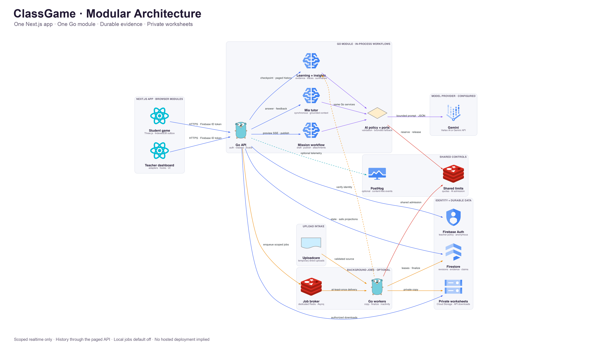
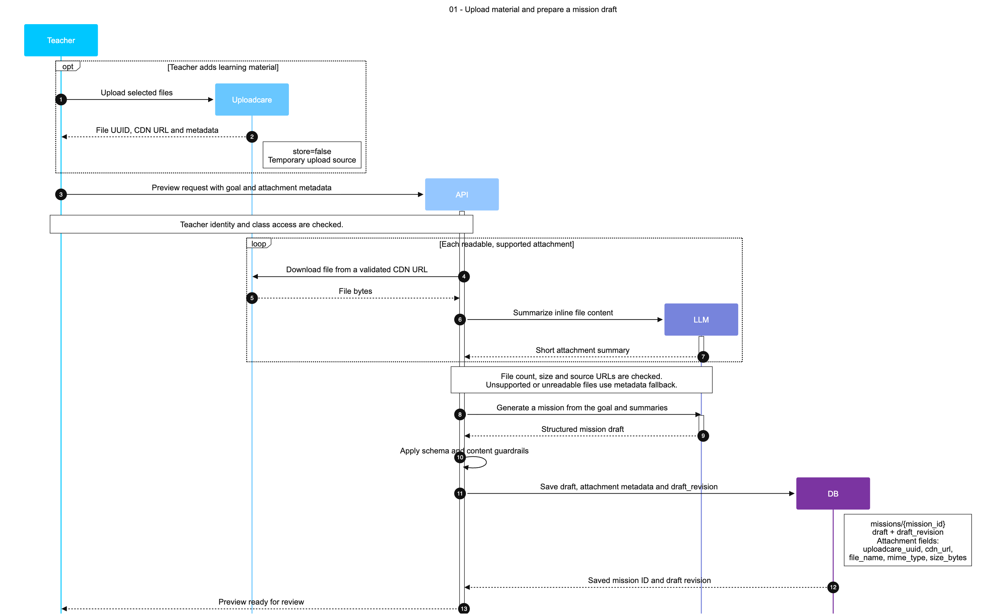
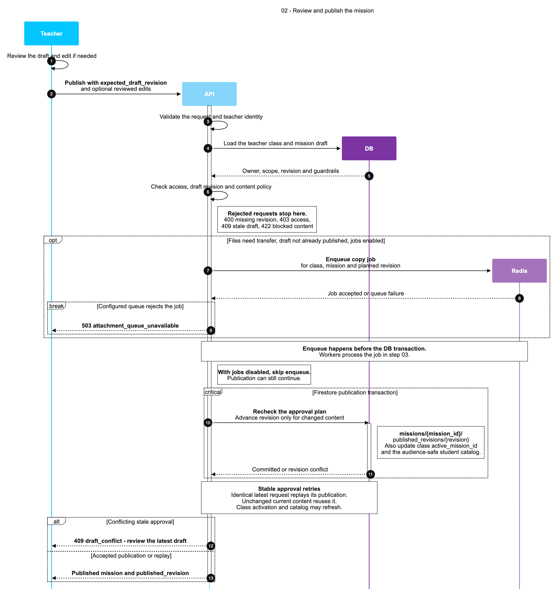
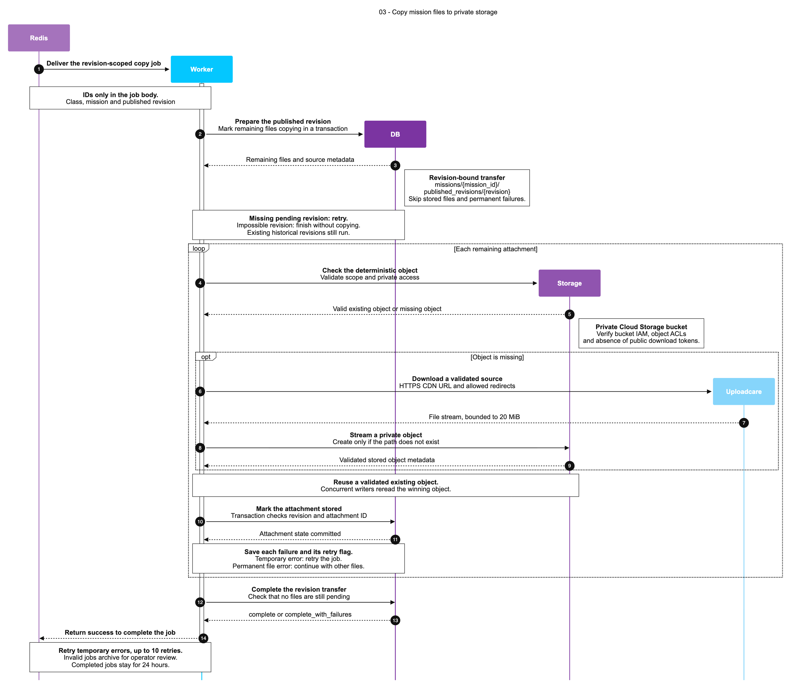
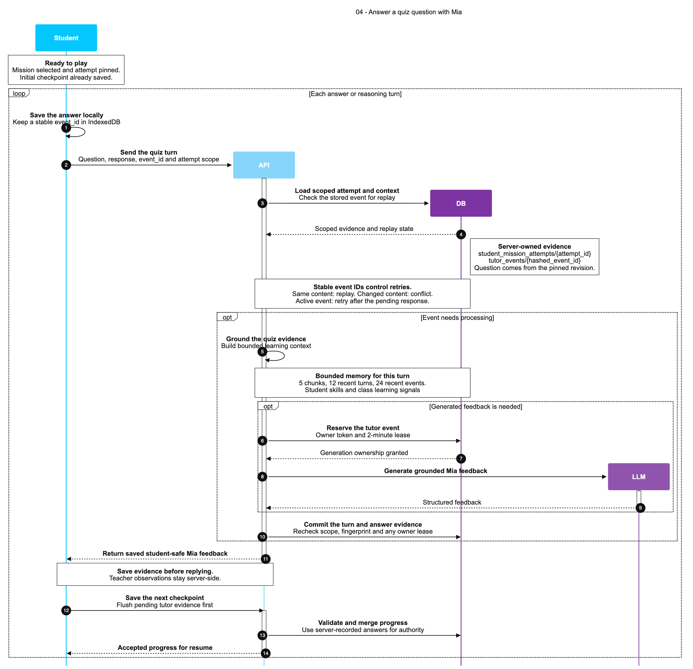
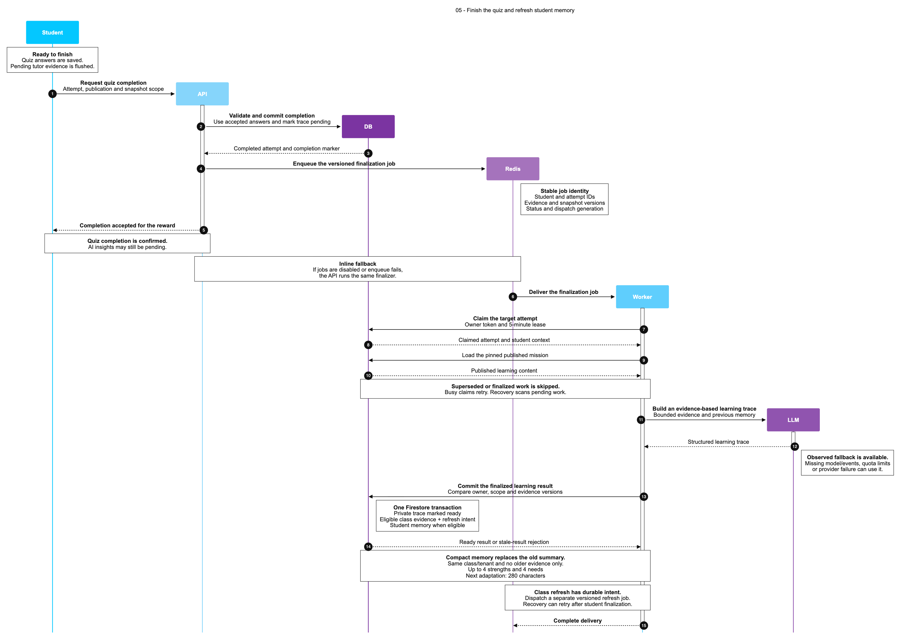
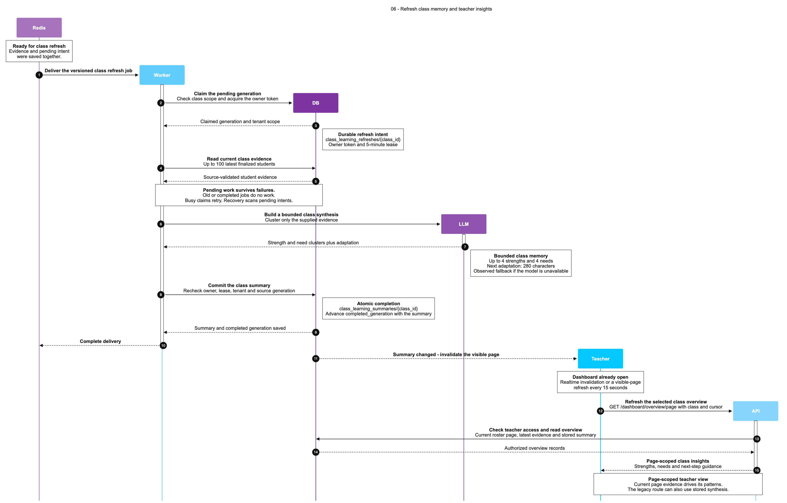

# ClassGame

**The optional homework that takes notes for the teacher.**

A teacher describes today's lesson. Mia creates a short review mission; students play in a 3D classroom, receive adaptive help, and leave observable learning evidence for the teacher.

[Watch the demo](https://www.youtube.com/watch?v=mvsbSKlGfyE) · [Run locally](docs/development/LOCAL-SETUP.md) · [Documentation](docs/README.md) · [API reference](docs/reference/API.md)

The previous hosted deployment is offline. See [hosting history](docs/operations/HOSTING-HISTORY.md) for its dated shutdown record.

## Architecture

One Next.js application, one Go API, and Firebase-backed learning state. Read the [system overview](docs/architecture/SYSTEM.md) and [module boundaries](docs/architecture/MODULES.md).

<p align="center">
  
</p>

## Architecture decisions and trade-offs

These choices fit the current code. The alternatives below are comparison options, not a record of benchmark wins or a plan to rewrite the stack. Each row compares at most three options, including the current choice.

| Decision and current choice | Relevant alternatives | Why it fits ClassGame | Trade-off / when to reconsider |
| --- | --- | --- | --- |
| **API: Go** | Node.js/TypeScript; Python | One typed module shares domain policies between HTTP handlers and workers. Request cancellation and bounded model calls are explicit. The [API container](api/infra/cloud-run/Dockerfile) runs one static binary. | Go and frontend TypeScript contracts still need to stay aligned. Node.js would share more language/tooling with the web; Python would fit Python-native ML libraries. No comparative latency or memory benchmark is claimed; provider response time still needs measurement. |
| **Evals: Python with small Go/Node bridges** | TypeScript runner; Go runner | Python's standard library handles JSON cases, selection, assertions and reports. Bridges call actual production Go/TypeScript policies instead of rewriting business rules in Python. See [evaluation scope](docs/ai/EVALUATIONS.md). | This adds a third language/toolchain. A Go or TypeScript runner could reduce one part of the setup, but still needs access to the other language's policies. Default synthetic checks verify contracts and fallbacks, not live teaching quality; local integration and human/model assessment are separate. |
| **Web: Next.js + React** | [React + Vite](https://vite.dev/guide/) | One app provides teacher routes, shared layouts and React UI around the browser-based Three.js classroom. The [standalone build](web/next.config.ts) can run in a Node container rather than requiring one hosting provider. | The current deployment includes a Node server and needs clear server/client boundaries; Three.js still runs in the browser. A Vite SPA could simplify static hosting, with a routing/layout setup and migration cost. Next.js is useful structure here, not a requirement for 3D or proof of better game performance. |
| **Durable data: Firestore, alongside Firebase Auth** | PostgreSQL; MongoDB | Document state and transactions fit mission revisions and learning attempts. Selected projections use realtime browser reads; Firebase Auth handles identity separately. Browser Firestore writes are denied; mutations use the API. See [data model](docs/reference/DATA-MODEL.md) and [access rules](firestore.rules). | Firestore needs planned indexes and denormalized projections, and keeps a Google-specific data/access model. PostgreSQL fits relational constraints and join-heavy reporting; MongoDB keeps a document model with different query/hosting choices. Either migration must replace the current realtime/read-rule integration and preserve transactions and access checks; it is not just a new connection URL. |
| **Background delivery: Redis + Asynq** | Google Cloud Tasks | A dedicated Redis broker and Go workers run locally or on another cloud without Cloud Tasks delivery endpoints or Google OIDC setup. Module-owned messages keep job meaning outside the transport. See [task portability](docs/architecture/TASK-PORTABILITY.md). | Cloud Tasks manages the queue service; Redis moves broker persistence, capacity, backups and worker operation to us. Delivery can repeat: stable IDs and domain checks remain necessary. The current adapter needs standalone-compatible Redis, not an assumed Redis Cluster deployment. Prefer managed delivery if lower operating effort matters more than queue portability. |
| **Application shape: modular monolith with API/worker roles** | Separate microservices | One Go module reuses the same policies and processors, with narrow module contracts. API and worker processes can have separate roles without splitting business logic into network services. See [system boundaries](docs/architecture/SYSTEM.md). | Releases must keep producers, workers and stored contracts compatible. Separate services become useful when independent ownership, isolation or scaling needs justify extra network calls, deployments and recovery work. A small project does not need that cost by default. |

Two boundaries matter when discussing portability:

- **Redis is not the durable learning database.** `TASKS_REDIS_URL` is a dedicated job broker; `REDIS_URL` handles quotas and shared AI admission. Firestore keeps accepted learning state and recovery markers. Broker loss still needs recovery; retries do not guarantee exactly-once external effects. [Queue operations](docs/operations/QUEUES.md).
- **Moving compute is different from replacing services.** API/web containers and a compatible Redis broker can move to another host, but Firebase Auth, Firestore, object storage and Google AI remain dependencies. Mia's interactive tutor calls stay synchronous; file copies and selected learning jobs run in the background. [Architecture](docs/architecture/SYSTEM.md).

Provider references: [Go concurrency](https://go.dev/doc/faq#goroutines), [Node.js I/O and CPU work](https://nodejs.org/en/learn/asynchronous-work/dont-block-the-event-loop), [Next.js static-export limits](https://nextjs.org/docs/app/guides/static-exports#unsupported-features), [Firestore transactions](https://firebase.google.com/docs/firestore/manage-data/transactions), [PostgreSQL constraints](https://www.postgresql.org/docs/current/ddl-constraints.html), [MongoDB data modeling](https://www.mongodb.com/docs/manual/data-modeling/), and [Cloud Tasks delivery](https://docs.cloud.google.com/tasks/docs/dual-overview).

## Mission flows

Read the steps in order. **Starts with** shows who begins each flow. Select a diagram to open the full PNG. See the [step index](assets/diagrams/steps/README.md) for all diagrams and the style guide.

| Step | Starts with | Flow | Diagram |
|:---:|---|---|:---:|
| 01 | **Teacher** | **Upload material and prepare a mission draft**<br>Upload optional files, generate questions, and save a draft for teacher review.<br>[Guide](assets/diagrams/steps/01-mission-draft/README.md) · [Mermaid source](assets/diagrams/steps/01-mission-draft/SEQUENCE.txt) | <a href="assets/diagrams/steps/01-mission-draft/diagram.png"></a> |
| 02 | **Teacher** | **Review and publish the mission**<br>Check the reviewed revision, prepare file-copy jobs, and publish through a DB transaction.<br>[Guide](assets/diagrams/steps/02-mission-publication/README.md) · [Mermaid source](assets/diagrams/steps/02-mission-publication/SEQUENCE.txt) | <a href="assets/diagrams/steps/02-mission-publication/diagram.png"></a> |
| 03 | **Redis** | **Copy mission files to private storage**<br>Workers load the published revision, copy files with retry checks, and save each result.<br>[Guide](assets/diagrams/steps/03-attachment-transfer/README.md) · [Mermaid source](assets/diagrams/steps/03-attachment-transfer/SEQUENCE.txt) | <a href="assets/diagrams/steps/03-attachment-transfer/diagram.png"></a> |
| 04 | **Student** | **Answer a quiz question with Mia**<br>Save the answer locally, get grounded feedback with bounded context, and save progress.<br>[Guide](assets/diagrams/steps/04-quiz-play/README.md) · [Mermaid source](assets/diagrams/steps/04-quiz-play/SEQUENCE.txt) | <a href="assets/diagrams/steps/04-quiz-play/diagram.png"></a> |
| 05 | **Student** | **Finish the quiz and refresh student memory**<br>Confirm completion, finalize private evidence, and replace the compact student memory.<br>[Guide](assets/diagrams/steps/05-learning-memory/README.md) · [Mermaid source](assets/diagrams/steps/05-learning-memory/SEQUENCE.txt) | <a href="assets/diagrams/steps/05-learning-memory/diagram.png"></a> |
| 06 | **Redis** | **Refresh class memory and teacher insights**<br>Build a bounded class summary, reject stale work, and refresh the teacher's visible insights.<br>[Guide](assets/diagrams/steps/06-class-insights/README.md) · [Mermaid source](assets/diagrams/steps/06-class-insights/SEQUENCE.txt) | <a href="assets/diagrams/steps/06-class-insights/diagram.png"></a> |

## Product tour

Every screen below is from the working product. Select any image to open it at full resolution.

| Student experience | Teacher experience |
|:---:|:---:|
| **Join a class in seconds**<br><a href="assets/pitch/01-0.png"></a> | **Student and teacher experiences, side by side**<br><a href="assets/pitch/01-1.png"></a> |
| **Explore the 3D classroom**<br><a href="assets/pitch/01-2.png"></a> | **Create a mission with Mia**<br><a href="assets/pitch/02-1.png"></a> |
| **Ground missions in real worksheets**<br><a href="assets/pitch/02-2.png"></a> | **Review and refine AI-generated questions**<br><a href="assets/pitch/02-3.png"></a> |
| **Inspect the mission flow**<br><a href="assets/pitch/02-4.png"></a> | **Publish the mission to the class**<br><a href="assets/pitch/03-1.png"></a> |
| **Choose a mission from the classroom**<br><a href="assets/pitch/03-2.png"></a> | **Follow live, grounded tutor turns**<br><a href="assets/pitch/03-3.png"></a> |
| **See the evidence-backed learning flow**<br><a href="assets/pitch/03-4.png"></a> | **Turn the completed mission into insight**<br><a href="assets/pitch/03-5.png"></a> |
| **Understand the whole class at a glance**<br><a href="assets/pitch/04-1.png"></a> | **Inspect the production architecture in-app**<br><a href="assets/pitch/05-1.png"></a> |

---

## Reproducible setup and testing

Use the canonical [local setup](docs/development/LOCAL-SETUP.md), [configuration](docs/reference/CONFIGURATION.md), and [validation](docs/development/VALIDATION.md) guides.

Clone [velrino/classgame](https://github.com/velrino/classgame), configure Firebase and Redis, then start `api/` and `web/` as described in [local setup](docs/development/LOCAL-SETUP.md). Open [teacher login](http://localhost:3000/login) or the [student game](http://localhost:3000/home).

## Documentation

Start with [docs/README.md](docs/README.md): architecture, development, operations, API/configuration reference, and implementation plans each have a canonical home.

Coding assistance starts at the [root router](AGENTS.md) and scoped package guides. Use the [AI index](docs/ai/README.md) for workspace/evaluation guidance and [processes](docs/processes/README.md) for review and release integration.

## Deployment

See [Cloud Run operations](docs/operations/CLOUD-RUN.md). Local execution does not recreate deleted hosted resources.

## Repository layout

```text
api/       Go API and provider integrations
web/       Next.js dashboard and student game
docs/      Canonical project documentation
agents/    AI contribution and workspace contracts
assets/    Source media, credits, and generation notes
scripts/   Operational and asset commands
```

## Credits

[Classroom model](https://sketchfab.com/3d-models/low-poly-classroom-8b1bf103c90349d981c9c2ae1c0596e5) by Mumladze28; [avatar credits and generation notes](assets/3d/avatars/chibi-band/README.md); [worksheet sources](assets/grade/README.md). Asset licenses stay beside their files. The dashboard uses shadcn/ui and a shell adapted from shadcn-admin.
